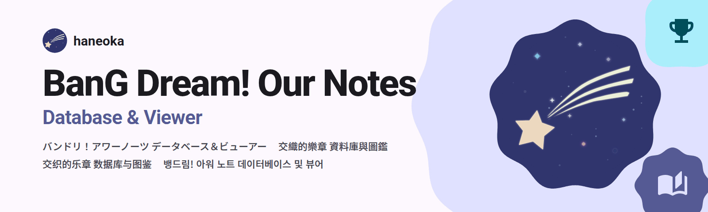

<p align="center">
  
</p>

# Haneoka

[](https://github.com/haneoka-gakuen/haneoka/actions/workflows/ci.yml)
[](https://github.com/haneoka-gakuen/haneoka/actions/workflows/deploy-cloudflare.yml)
[](LICENSE)

Unofficial database, tools and community for *BanG Dream! Our Notes*, at [haneoka.org](https://haneoka.org).

## Features

- Searchable catalogue in five languages, for every server
- Audio, video, comic, Live2D, Spine and story viewers
- Chart and story players, with Sonolus-compatible engines
- Team builder with separate server inventories, event planning, card import, manual skill-order editing and best/worst cumulative-timing score goals
- Chart editor with an on-demand beginner guide, practice chart, compact original-note tools, direct canvas editing, three flick directions, SEKAI chart import into Our Notes, Bestdori-style shortcuts, cloud drafts, version history, publishing and remixes; authors can continue editing their charts from the detail page
- Community charts ranked by the shared post recommendation system, with latest, popularity and difficulty sorting
- Gekiso Arena schedule, rankings, song rules and team building
- Event trackers, player lookup, song rankings and calendars
- Community posts, playlists and accounts
- Embeddable players and a [public API](https://docs.haneoka.org)
- [Native app](https://github.com/haneoka-gakuen/haneoka-app) for Android, iOS, Windows, macOS and Linux

The site is an Astro application with route-scoped Lit workspaces. `src/components` holds the shell, `src/lit` the workspaces, and `src/styles` the Material Design 3 styles.

## Development

Start with the [repository map](L1.md) and [development guide](docs/DEV_GUIDE.md)
to find the relevant source area and checks. Architecture maps and core file
coordinates follow the [GEB maintenance guide](docs/GEB使用与维护指南.md).

Requirements:

- Node.js 24 and Corepack
- Python 3.13, FFmpeg, and `vgmstream-cli` when processing resources
- A modern WebGL2 browser for interactive renderers

```sh
corepack enable
pnpm install --frozen-lockfile
pnpm typecheck
pnpm lint
HANEOKA_CUBISM_RUNTIME_POLICY=optional pnpm build
```

Run the application and Worker locally:

```sh
cp .dev.vars.example .dev.vars
pnpm db:schema:bootstrap:local
pnpm dev:worker
pnpm dev
```

For a static build with the local catalog preview server:

```sh
pnpm build
HOST=127.0.0.1 PORT=3000 pnpm preview
```

A complete catalog requires an authorized resource release. Build one with the
[resource pipeline](scripts/README.md), or set `RESOURCE_RELEASE_ROOT` to an
existing release directory. Cubism playback also requires an authorized
runtime at the path printed by `pnpm runtime:cubism:source-path`, or through
`HANEOKA_CUBISM_RUNTIME_DIR`.

For Bestdori content, provide a local mirror containing `api/`, `assets/`, and
`res/` to the Worker:

```sh
BESTDORI_RAW_MIRROR_ROOT=/absolute/path/to/bestdori-mirror pnpm dev:worker
```

## Data and deployment

- Catalog documents and media are stored as immutable releases in R2.
- Accounts and community data use D1.
- Production schema changes use committed migrations under
  [`worker/database`](worker/database/README.md).
- Production deployment is defined in `wrangler.jsonc` and
  `.github/workflows/deploy-cloudflare.yml`.

Forks must configure their own Cloudflare Worker, D1 database, R2 buckets,
email sender, Turnstile widget, OAuth applications, domains, and secrets.
Never commit credentials, private packages, or licensed runtime files.

## Contributing

See [CONTRIBUTING.md](CONTRIBUTING.md), [SUPPORT.md](SUPPORT.md), and
[SECURITY.md](SECURITY.md).

## License

Haneoka-authored files are licensed under [MPL-2.0](LICENSE) unless noted
otherwise. Third-party runtimes, adapted code, fonts, icons, and game materials
retain their own terms; see [THIRD_PARTY_NOTICES.md](THIRD_PARTY_NOTICES.md).

Haneoka is an unofficial project and is not affiliated with or endorsed by the
rights holders of _BanG Dream!_ or _BanG Dream! Our Notes_.
