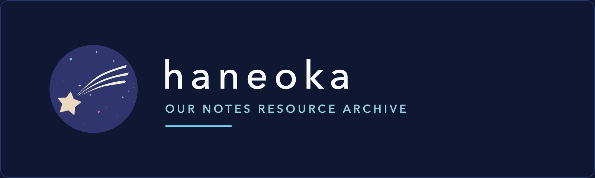

<p align="center">
  
</p>

# Haneoka

[](https://github.com/haneoka-gakuen/haneoka/actions/workflows/ci.yml)
[](https://github.com/haneoka-gakuen/haneoka/actions/workflows/deploy-cloudflare.yml)
[](LICENSE)

Unofficial resource archive and browser viewer for _BanG Dream! Our Notes_.

The production UI is a root-level Astro application with small, route-scoped
Lit workspaces. Shared shell and document components live in `src/components`,
interactive workspaces in `src/lit`, and the Material Design 3 styles in
`src/styles`.

- [Catalog](https://haneoka.org/catalog)
- Searchable multilingual game data
- Audio, video, comic, Live2D, story, and asset viewers
- Interactive chart and story players
- ADV story playback and authoring
- Sonolus-compatible play, watch, preview, and tutorial engines
- Accounts and community features
- Team builder with separate server inventories and reviewed cross-server JSON imports
- Community chart publishing, cloud drafts, version history, remixes, and Sonolus play

The chart editor saves local revisions automatically and reopens the latest local
project. Its Publish dialog selects audio and cover independently: upload your
own files or reuse Our Notes and Bestdori song resources. Our Notes references
retain their release identity. Reused audio and covers are copied into deduplicated
community snapshots, so release cleanup does not break published charts. Uploaded audio is prepared as stereo PCM WAV;
uploaded covers use the community media and moderation pipeline.

Cloud drafts stay private while the previous published version remains playable.
Publish publicly or by link, choose remix availability, then open the chart in
Sonolus from its community page. Community details share song playback, chart,
and Sonolus actions with official songs. The chart child page uses the same 2D
overview, 3D player, settings, and image download. Playback remains available when
remixes are closed. Community charts also share the official chart summary and
FC operation-load difficulty model. Authors set their own level; the recommended
level, note count, duration, BPM, and density are computed by the server for each
immutable revision. Saved cloud drafts can open their private detail page before
publication. The Sonolus server has a separate Community Charts section;
community levels do not enter the default official list. Withdrawal removes
public chart and media access; deleted chart payloads are retained for 30 days before cleanup. Project backups include audio,
cover and publication settings, and import as a new local project.

Event rewards are organized into farming recommendations and resource planning.
Farming keeps its own play, reward and input conditions, including ordinary,
Gekiso, challenge and skip routes. Existing reward weights and CP conversion remain available.
Automatic and manual Gekiso scoring use a Luck sample count of 0 for nominal expectations;
a positive count averages fixed seeds 0 through n-1. Manual Gekiso evaluation
and replacement suggestions share the selected accuracy, placement and sample count.

## Development

Start with the [repository map](L1.md) and [development guide](docs/DEV_GUIDE.md)
to find the relevant source area and checks. Architecture maps and core file
coordinates follow the [GEB maintenance guide](docs/GEB使用与维护指南.md).

Requirements:

- Node.js 24 and Corepack
- Python 3.13, FFmpeg, and `vgmstream-cli` when processing resources
- A modern WebGL2 browser for interactive renderers

```sh
corepack enable
pnpm install --frozen-lockfile
pnpm typecheck
pnpm lint
HANEOKA_CUBISM_RUNTIME_POLICY=optional pnpm build
```

Run the application and Worker locally:

```sh
cp .dev.vars.example .dev.vars
pnpm db:schema:bootstrap:local
pnpm dev:worker
pnpm dev
```

For a static build with the local catalog preview server:

```sh
pnpm build
HOST=127.0.0.1 PORT=3000 pnpm preview
```

A complete catalog requires an authorized resource release. Build one with the
[resource pipeline](scripts/README.md), or set `RESOURCE_RELEASE_ROOT` to an
existing release directory. Cubism playback also requires an authorized
runtime at the path printed by `pnpm runtime:cubism:source-path`, or through
`HANEOKA_CUBISM_RUNTIME_DIR`.

For Bestdori content, provide a local mirror containing `api/`, `assets/`, and
`res/` to the Worker:

```sh
BESTDORI_RAW_MIRROR_ROOT=/absolute/path/to/bestdori-mirror pnpm dev:worker
```

## Data and deployment

- Catalog documents and media are stored as immutable releases in R2.
- Accounts and community data use D1.
- Production schema changes use committed migrations under
  [`worker/database`](worker/database/README.md).
- Production deployment is defined in `wrangler.jsonc` and
  `.github/workflows/deploy-cloudflare.yml`.

Forks must configure their own Cloudflare Worker, D1 database, R2 buckets,
email sender, Turnstile widget, OAuth applications, domains, and secrets.
Never commit credentials, private packages, or licensed runtime files.

## Contributing

See [CONTRIBUTING.md](CONTRIBUTING.md), [SUPPORT.md](SUPPORT.md), and
[SECURITY.md](SECURITY.md).

## License

Haneoka-authored files are licensed under [MPL-2.0](LICENSE) unless noted
otherwise. Third-party runtimes, adapted code, fonts, icons, and game materials
retain their own terms; see [THIRD_PARTY_NOTICES.md](THIRD_PARTY_NOTICES.md).

Haneoka is an unofficial project and is not affiliated with or endorsed by the
rights holders of _BanG Dream!_ or _BanG Dream! Our Notes_.
